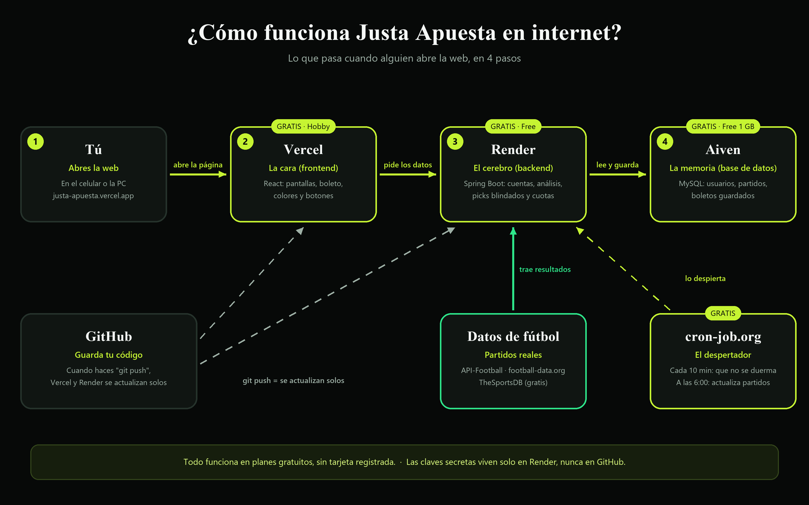

# Justa Apuesta

App web *mobile-first* de **análisis de partidos de fútbol y probabilidades** con datos reales. Muestra quién gana, los mercados más probables, el **pick blindado** (el que pasa 5 pruebas con datos reales), cuotas aproximadas y combinadas seguras, y permite armar un **boleto** que se comparte por link o como imagen.

> **No permite apostar.** Es una herramienta de análisis. Solo +18. Juega con responsabilidad.

**Web en vivo:** https://justa-apuesta.vercel.app

📄 **Guía rápida de publicación (PDF):** [docs/Guia-Publicacion-Justa-Apuesta.pdf](docs/Guia-Publicacion-Justa-Apuesta.pdf)



---

## Índice

1. [Qué hace la app](#1-qué-hace-la-app)
2. [Tecnologías](#2-tecnologías)
3. [Estructura del proyecto](#3-estructura-del-proyecto)
4. [De dónde salen los datos](#4-de-dónde-salen-los-datos)
5. [Cómo se calculan las probabilidades](#5-cómo-se-calculan-las-probabilidades)
6. [Diseño](#6-diseño)
7. [Correrlo en tu PC](#7-correrlo-en-tu-pc)
8. [Cómo se publicó en internet (paso a paso)](#8-cómo-se-publicó-en-internet-paso-a-paso)
9. [Variables de entorno](#9-variables-de-entorno)
10. [Cómo actualizar la web](#10-cómo-actualizar-la-web)
11. [Si algo falla](#11-si-algo-falla)
12. [¿Cuánto cuesta?](#12-cuánto-cuesta)
13. [API del backend](#13-api-del-backend)
14. [Historial de lo que se construyó](#14-historial-de-lo-que-se-construyó)

---

## 1. Qué hace la app

| Pantalla | Qué tiene |
|---|---|
| **Partidos** | Pestañas *Jugados · Hoy · Próximos* (un partido pasa de Hoy a Jugados en cuanto empieza), agrupados por liga (tus ligas favoritas primero). Buscador de **cualquier equipo** del mundo. Cada tarjeta muestra el consejo del partido con su % y su cuota aproximada. |
| **Detalle del partido** | Racha de los últimos 5 de cada equipo, **¿Quién gana?**, el **consejo** (pick blindado con sus 5 pruebas), "También probable" y "Evita", enfrentamientos directos, **todos los mercados** (goles, corners, tarjetas, remates, ganador) con cuota y botón **+** para el boleto, cara a cara y jugadores clave. |
| **Picks** | **Combinadas seguras** (Muy segura · Segura · Para el reto) armadas solo con picks blindados, y el ranking de **mejores picks** del día. |
| **Mi boleto** | Barra que sube desde abajo con los picks que agregaste: probabilidad total, cuota total, **compartir link** (se abre sin cuenta) e **imagen** tipo ticket. |
| **Favoritos** | Los partidos que marcaste con la estrella. |
| **Perfil** | Tus cifras (picks, acertados, % de acierto), **modo** (Seguro · Equilibrado · Arriesgado), **apariencia** (oscuro / claro / auto y 5 colores), ligas favoritas e historial de picks. |

Funciona igual en celular y en PC: en pantallas grandes el menú pasa a la izquierda, las tarjetas se ponen en columnas y el detalle en dos columnas.

---

## 2. Tecnologías

| Parte | Tecnología |
|---|---|
| **Backend** | Java 21 · Spring Boot 4.1 · Spring Security + JWT (jjwt) · Spring Data JPA (Hibernate 7) · Flyway · Maven |
| **Base de datos** | MySQL 8 (Aiven, en producción) · MariaDB 10.4 de XAMPP (en tu PC) · H2 (en los tests) |
| **Frontend** | React 19 · Vite · TypeScript · React Router 7 · TanStack Query · CSS Modules |
| **Letras** | Tinos (igual a Times New Roman) para títulos y números · Inter para el texto |
| **Hosting** | Vercel (web) · Render con Docker (backend) · Aiven (MySQL) · cron-job.org (tareas programadas) · GitHub (código) |

---

## 3. Estructura del proyecto

```
CuotaJusta/
├── backend/                     Spring Boot (API)
│   ├── Dockerfile               Cómo Render compila y corre el backend
│   ├── pom.xml
│   └── src/main/
│       ├── java/pe/justaapuesta/
│       │   ├── analisis/        Motor de probabilidades, pick blindado, análisis del partido
│       │   ├── auth/            Registro, login y JWT
│       │   ├── historial/       football-data.org y TheSportsDB (historial y búsqueda)
│       │   ├── partido/         Partidos, equipos, ligas, búsqueda
│       │   ├── picks/           Picks del día, combinadas, favoritos, boleto y boletos compartidos
│       │   ├── proveedor/       API-Football (partidos y estadísticas) y límite de consultas
│       │   ├── security/        Configuración de seguridad y CORS
│       │   ├── sync/            Sincronización diaria y endpoint /api/admin/sync
│       │   └── usuario/         Perfil, modo y apariencia
│       └── resources/
│           ├── application.yml          Configuración común (ligas, límites, horarios)
│           ├── application-local.yml    Tu PC (XAMPP)
│           ├── application-prod.yml     Render + Aiven
│           └── db/migration/            Tablas (Flyway V1 a V7)
├── frontend/                    React (la web)
│   ├── vercel.json              Para que los links /b/código abran bien en Vercel
│   └── src/
│       ├── api/                 Llamadas al backend y tipos
│       ├── components/          Tarjetas, boleto, menú, detalle del partido
│       ├── hooks/               useBoleto, useFavorito…
│       ├── lib/                 Formatos, apariencia, imagen del boleto
│       ├── pages/               Partidos, Detalle, Picks, Favoritos, Perfil, Boleto público
│       └── styles/              Colores (tokens.css) y estilos comunes
├── docs/                        Guía en PDF e imagen de cómo funciona
└── docker-compose.yml           MySQL 8 opcional en Docker
```

---

## 4. De dónde salen los datos

Todo es **real** y **gratis**; nada se inventa. El frontend nunca llama a estas APIs: todo pasa por el backend y se guarda en la base de datos.

| Fuente | Qué trae | Límite gratis |
|---|---|---|
| **API-Football** | Partidos de ayer, hoy y mañana, estadísticas (corners, tarjetas, remates), jugadores y enfrentamientos directos | 100 consultas al día, 10 por minuto |
| **football-data.org** | Temporada actual **y la pasada** completas de 10 competiciones (Premier, LaLiga, Serie A, Bundesliga, Ligue 1, Champions, Primeira Liga, Eredivisie, Brasileirão, Championship) | 10 consultas por minuto |
| **TheSportsDB** | Equipos de otras ligas del mundo cuando los buscas (por ejemplo, Universitario o Alianza Lima) | Clave pública |

- **Sincronización diaria:** a las 4:30 a. m. (Lima) en tu PC, y en internet la lanza cron-job.org a las 6:00. Baja los partidos, estadísticas, historial y la temporada pasada (esta solo una vez).
- **Búsqueda:** si un equipo no está guardado, se busca en TheSportsDB y se bajan sus partidos recientes y próximos. Cada búsqueda se recuerda 7 días.
- Los equipos que vienen de varias fuentes se unen por nombre y país.
- Si se acaban las consultas del día, la app sigue mostrando lo guardado.
- **Carga rápida:** el análisis de los partidos de las pestañas se calcula de antemano en segundo plano (al arrancar y después de cada sincronización), y las listas de cada pestaña y de Picks quedan **armadas en memoria** por modo. Abrir la web solo lee esa lista (en local, ~20–30 ms). Si una lista tiene más de 3 minutos, se rehace aparte sin hacer esperar. Las respuestas de más de 1 segundo quedan anotadas en el log ("Respuesta lenta").
- **Corners, tarjetas y remates** solo vienen de API-Football (1 consulta por partido, solo de ayer/hoy/mañana en el plan gratis). Aparecen cuando cada equipo junta 3 partidos con esas estadísticas, así que en una base nueva tardan unas semanas en salir. Se mira cómo juega el local en casa y el visitante fuera cuando hay datos suficientes.

---

## 5. Cómo se calculan las probabilidades

Código: `backend/src/main/java/pe/justaapuesta/analisis/` (`Motor.java` y `EntradasService.java`).

1. **Goles esperados:** se calculan con los **últimos 10 partidos reales de cada equipo anteriores al partido** (en casa el local, fuera el visitante). Los partidos más recientes pesan más.
2. **Ajuste por liga:** si un equipo tiene pocos partidos, su número se acerca al promedio de su liga (con 10 partidos la liga pesa 1/3; con 5, la mitad). Así una goleada no exagera todo.
3. **Forma y localía:** ±10% según la racha y +5% / −5% por jugar de local o visita.
4. **Modelo de Poisson con corrección de Dixon-Coles:** da la probabilidad de cada marcador (0-0, 1-0…), corrigiendo los marcadores bajos que el Poisson simple calcula mal.
5. **Mercados:** solo las líneas que ofrecen las casas, en 8 categorías:
   - **Goles:** más de 1.5 / 2.5 / 3.5, menos de 2.5 / 3.5, ambos marcan sí / no.
   - **Equipos:** cada equipo marca, cada equipo más de 1.5 goles, cada equipo no recibe gol.
   - **Combinados:** gana y más de 1.5 goles, local o empate y menos de 3.5, ambos marcan y más de 2.5, gana sin recibir gol.
   - **Corners** 7.5 a 10.5 y por equipo, **tarjetas** 2.5 a 5.5, **remates a puerta** y **remates totales** (cuando hay estadísticas).
   - **Ganador:** 1 X 2, doble oportunidad y "no hay empate".

   Una categoría sin datos reales (por ejemplo, sin corners) no se muestra.
6. **Certeza final:** 55% el modelo + 30% lo que de verdad pasó en los últimos partidos de ambos equipos + 15% la liga.
7. **Pick blindado:** solo si la certeza final es **82% o más**, el mercado no está entre los que la medición mostró que prometen de más (menos de 3.5, más de 2.5, ambos marcan, cada equipo más de 1.5) y pasa **las 5 pruebas**:
   - el modelo da 75% o más;
   - el local lo cumplió en **8 de cada 10** de sus partidos;
   - el visitante, igual;
   - los enfrentamientos directos lo cumplen en 67% (si hay datos);
   - la liga lo cumple en 70% (si hay datos).
8. **Cuota aproximada:** `1 / (probabilidad × 1.06)`, es decir, con el margen típico de una casa (~6%). Los picks con cuota menor a **1.05** no se recomiendan, porque casi no pagan.
9. **Combinadas seguras:** solo picks blindados de partidos distintos, de mayor a menor certeza (2, 3 y 4 picks).

### Acierto real (medido)

`PrecisionService` toma los partidos ya jugados, calcula su análisis **solo con los datos de antes de cada partido** (lo mismo que se habría mostrado ese día) y lo compara con el resultado. Con eso se ajustaron las reglas:

| Medido en 867 partidos jugados | Antes | Ahora |
|---|---|---|
| Pick blindado | 78% | **84%** (82%+ de certeza y cuota desde 1.05) |
| Consejo del modo Seguro | 79% | **82%** |

Las probabilidades están bien calibradas: lo que sale con 80–84% acertó el 81%; con 90% o más, el 93%. Ningún pick es seguro al 100%: un 84% falla más o menos 1 de cada 6. La app muestra el acierto real en la pantalla de Picks (`GET /api/precision`), y se vuelve a medir dos veces al día.

El análisis hecho **antes** de cada partido se guarda (`analisis_cache`), así lo que muestra un partido jugado es lo que se dijo antes, y se marca con ✓ o ✗.

---

## 6. Diseño

- **Estilo:** negro profundo, blanco claro y verde limón (inspirado en un marcador de estadio).
- **Letras:** Tinos (Times) en negrita para nombres de equipos, títulos y porcentajes; Inter para el texto chico.
- **Colores con significado:** verde = probable / acertó, rojo = poco probable / falló. No cambian con el color elegido.
- **Apariencia en el Perfil:** tema Oscuro / Claro / Auto y 5 colores (Limón, Verde, Celeste, Morado, Naranja). Se guarda en la cuenta.
- Todos los colores están en `frontend/src/styles/tokens.css`.

---

## 7. Correrlo en tu PC

**Requisitos:** Java 21 (IntelliJ ya lo trae), Node 20+, MySQL de XAMPP.

1. **Claves:** en `backend/.env` (no se sube a GitHub) van:
   ```
   FOOTBALL_API_KEY=...
   FOOTBALL_DATA_ORG_KEY=...
   ADMIN_SYNC_KEY=...
   ```
2. **Base de datos:** enciende MySQL en XAMPP. La base `justa_apuesta` y sus tablas se crean solas.
   - XAMPP y el servicio de Windows `MySQL92` usan el puerto 3306: **solo uno puede estar encendido**.
3. **Backend:** en IntelliJ abre `backend/` y ejecuta `JustaApuestaApplication` (con Java 21), o:
   ```bash
   cd backend
   mvnw.cmd spring-boot:run
   ```
   Comprueba: http://localhost:8080/api/health
4. **Frontend:**
   ```bash
   cd frontend
   npm.cmd install
   npm.cmd run dev
   ```
   Abre http://localhost:5173

> Tu PC y Render usan la **misma clave de API-Football** (100 consultas al día compartidas). Si no estás programando, no prendas el backend de tu PC.

**Tests:**
```bash
cd backend
mvnw.cmd test
```
43 tests: motor de probabilidades, pick blindado, cuotas, lector de API-Football, historial, registro/login y el flujo completo (incluido el boleto compartido).

---

## 8. Cómo se publicó en internet (paso a paso)

| Parte | Servicio | Dirección |
|---|---|---|
| Web (frontend) | **Vercel** · plan Hobby | https://justa-apuesta.vercel.app |
| Backend (API) | **Render** · plan Free · Docker | https://justa-apuesta.onrender.com |
| Base de datos | **Aiven** · MySQL plan Free (1 GB) | (privada) |
| Código | **GitHub** · repositorio privado | este repositorio |
| Despertador | **cron-job.org** | — |

### Paso 1 · GitHub
1. Crear el repositorio **privado** `Justa-Apuesta` (sin README, sin .gitignore, sin licencia).
2. Subir el código desde `C:\CuotaJusta`:
   ```bash
   git init
   git add .
   git commit -m "Justa Apuesta"
   git branch -M main
   git remote add origin https://github.com/juandiegoramosenriquez-sys/Justa-Apuesta.git
   git push -u origin main
   ```
   El `.gitignore` evita que se suban `.env`, `node_modules`, `target` y `dist`.

### Paso 2 · Aiven (base de datos)
1. console.aiven.io/signup → entrar con Google.
2. **Create service** → **MySQL** → tier **Free** (plan `free-1-1gb`). ⚠️ No elegir *Developer* ni *Professional*: cobran.
3. Nombre `justa-apuesta-db` → **Create service** → esperar a que diga **Running**.
4. En **Connection information** están Host, Port, User (`avnadmin`) y Password. La dirección de conexión queda:
   ```
   jdbc:mysql://HOST:PUERTO/defaultdb?sslMode=REQUIRED
   ```

### Paso 3 · Render (backend)
1. render.com → entrar con **GitHub** → **New** → **Web Service** → dar permiso sobre el repositorio.
2. Name `Justa-Apuesta` · Language **Docker** · Branch `main` · Root Directory **`backend`** · Instance **Free**.
3. Agregar las [variables de entorno](#9-variables-de-entorno) (`JWT_SECRET` con el botón **Generate**).
4. **Deploy web service** → esperar **Live** (la primera vez tardó ~4 minutos).
5. Opcional: Settings → Health Checks → `/api/health`.

### Paso 4 · Vercel (web)
1. vercel.com → **Add New → Project** → instalar la app de GitHub sobre el repositorio → **Import**.
2. Project Name `justa-apuesta` · Root Directory **`frontend`** · Preset **Vite**.
3. Variable `VITE_API_URL` = `https://justa-apuesta.onrender.com` (sin `/` al final).
4. **Deploy** → queda en https://justa-apuesta.vercel.app
5. En Render, `FRONTEND_URL` debe ser exactamente esa dirección (si no, la web no puede iniciar sesión).

### Paso 5 · cron-job.org (despertador)
| Tarea | URL | Cada cuánto | Extra |
|---|---|---|---|
| **Despertar Justa Apuesta** | `https://justa-apuesta.onrender.com/api/health` | Cada 10 minutos | — |
| **Sincronizar partidos** | `https://justa-apuesta.onrender.com/api/admin/sync` | Todos los días a las 6:00 (America/Lima) | Pestaña *Avanzado*: método **POST** y cabecera `X-Admin-Key` = tu `ADMIN_SYNC_KEY` |

El primero evita que Render se duerma (se duerme a los 15 minutos sin visitas). El segundo actualiza los partidos cada día.

---

## 9. Variables de entorno

Nunca van en GitHub. En tu PC están en `backend/.env`; en internet, en **Render → Justa-Apuesta → Environment** (menú *Manage*).

| Variable | Dónde | Qué es |
|---|---|---|
| `DB_URL` | Render | `jdbc:mysql://HOST:PUERTO/defaultdb?sslMode=REQUIRED` (de Aiven) |
| `DB_USER` | Render | `avnadmin` |
| `DB_PASSWORD` | Render | Contraseña de Aiven |
| `JWT_SECRET` | Render | Clave larga aleatoria para las sesiones |
| `FOOTBALL_API_KEY` | Render y `.env` | Clave de API-Football |
| `FOOTBALL_DATA_ORG_KEY` | Render y `.env` | Clave de football-data.org |
| `ADMIN_SYNC_KEY` | Render, `.env` y cron-job.org | Clave para lanzar la sincronización |
| `FRONTEND_URL` | Render | `https://justa-apuesta.vercel.app` |
| `VITE_API_URL` | Vercel | `https://justa-apuesta.onrender.com` |

El `Dockerfile` pone `SPRING_PROFILES_ACTIVE=prod`, que usa `application-prod.yml` (MySQL de Aiven y poca memoria para el plan gratis).

---

## 10. Cómo actualizar la web

Cambias el código en tu PC y lo subes:

```bash
git add .
git commit -m "lo que cambié"
git push
```

Render (backend) y Vercel (web) se vuelven a publicar **solos** en unos minutos.

> **Regla de la base de datos:** nunca modificar una migración que ya se aplicó (`backend/src/main/resources/db/migration/V1…V7`). Para cambiar tablas se crea una nueva (`V8__…sql`). Flyway la aplica sola al arrancar.

---

## 11. Si algo falla

| Pasa esto | Causa | Qué hacer |
|---|---|---|
| La web tarda ~1 minuto en abrir | Render estaba dormido | Normal en el plan gratis. Revisa que el cron *Despertar* esté activo. |
| No deja iniciar sesión | `FRONTEND_URL` no coincide con la dirección de Vercel | Render → Environment → corregirla → *Save, rebuild, and deploy*. |
| Salen pocos partidos | Se gastaron las 100 consultas de API-Football | Se llena solo al día siguiente. No prendas el backend de tu PC a la vez. |
| "Datos insuficientes" en un partido | El equipo tiene menos de 3 partidos guardados antes de esa fecha (por ejemplo, un recién ascendido) | Es honesto: no se inventa nada. Se completa con los días. |
| Render dice *Failed* | Error al compilar o arrancar | Render → Logs → revisar las últimas líneas. |
| La base de datos no responde | Aiven apagó el servicio Free por falta de uso | Aiven → el servicio → *Power on*. |
| En tu PC: "Migration checksum mismatch" | Se cambió una migración ya aplicada | No cambiar migraciones aplicadas; crear una nueva. |
| ¿Está vivo el backend? | — | https://justa-apuesta.onrender.com/api/health debe responder `"estado":"ok"`. |

---

## 12. ¿Cuánto cuesta?

**S/ 0.** Todo está en planes gratuitos (Vercel Hobby, Render Free, Aiven Free, GitHub Free, cron-job.org y las APIs en su plan gratis) y **no hay ninguna tarjeta registrada**, así que no pueden cobrar. Si se pasa un límite, el servicio se pausa o va lento; no llega un cobro.

- Las empresas pueden cambiar sus planes gratis en el futuro; normalmente avisan por correo con tiempo.
- No tocar *Upgrade*, *Pro*, *Developer* ni *Professional*, ni agregar tarjeta: eso sí cobra.
- Vercel Hobby es para uso personal y sin fines comerciales.
- Un dominio propio (por ejemplo `justaapuesta.com`) es opcional y cuesta unos US$10–15 al año.

---

## 13. API del backend

Todas bajo `/api`. Las marcadas con 🔒 necesitan sesión (`Authorization: Bearer <token>`).

| Método | Ruta | Qué hace |
|---|---|---|
| GET | `/health` | Estado del backend y la base de datos |
| POST | `/auth/registro` · `/auth/login` | Crear cuenta · iniciar sesión |
| GET / PATCH 🔒 | `/me` | Tu perfil · cambiar modo, apariencia, ligas favoritas |
| GET 🔒 | `/partidos?estado=JUGADO\|HOY\|PROXIMO` | Lista de partidos con su consejo |
| GET 🔒 | `/buscar?q=texto` | Buscar equipos o ligas |
| GET 🔒 | `/partidos/{id}/analisis` | Análisis completo del partido |
| GET 🔒 | `/equipos/{id}/ultimos?n=5` | Últimos partidos de un equipo |
| GET 🔒 | `/ligas` | Ligas disponibles |
| GET 🔒 | `/picks?estado=HOY\|PROXIMO` | Combinadas seguras y mejores picks |
| GET 🔒 | `/precision` | Acierto real del pick blindado y del consejo |
| GET · POST · DELETE 🔒 | `/favoritos/{partidoId}` | Favoritos |
| GET · POST · DELETE 🔒 | `/picks-seguidos` | Picks del boleto e historial |
| DELETE 🔒 | `/picks-seguidos/pendientes` | Vaciar el boleto |
| POST 🔒 | `/boletos` | Crear el link para compartir el boleto |
| GET | `/publico/boletos/{codigo}` | Ver un boleto compartido (sin cuenta) |
| POST | `/admin/sync` | Lanzar la sincronización (cabecera `X-Admin-Key`) |
| POST | `/admin/precision?dias=30` | Medir el acierto real ahora (cabecera `X-Admin-Key`) |

---

## 14. Historial de lo que se construyó

1. **Base:** estructura del proyecto, MySQL, migraciones Flyway y Spring Boot.
2. **Cuentas:** registro, login y sesión con JWT; pantallas de login y registro.
3. **Datos reales:** API-Football con sincronización diaria y límite de consultas; luego football-data.org (temporada actual y pasada) y TheSportsDB (cualquier equipo del mundo), con unión de equipos entre fuentes.
4. **Motor de probabilidades:** Poisson con las fórmulas del prototipo; después Dixon-Coles, peso a partidos recientes, ajuste por liga y certeza mezclada con resultados reales.
5. **Pantallas:** lista por pestañas y ligas, buscador, tarjetas y detalle completo del partido.
6. **Picks:** favoritos, perfil, modos y resolución automática de picks (✓ / ✗).
7. **Pick blindado y cuotas:** 5 pruebas con datos reales, cuota aproximada, líneas que existen en las casas y combinadas seguras.
8. **Boleto:** barra que sube desde abajo, link público para compartir e imagen tipo ticket.
9. **Diseño:** estilo negro, blanco y verde; letras Times + Inter; tema claro/oscuro/auto y 5 colores; versión de PC más grande y textos más cortos.
10. **Publicación:** GitHub, Aiven, Render, Vercel y cron-job.org, todo gratis.
11. **Más acierto y más rápido:** medición del acierto real con partidos jugados y ajuste del pick blindado (78% → 84%), análisis precalculado en segundo plano, partidos empezados pasan a Jugados y estadísticas de local/visita.
